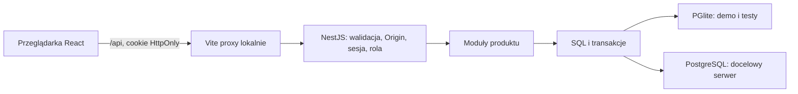

# Architektura szkieletu i następny etap

## Przepływ

Moduły API: `auth`, `projects`, `tasks`, `attendance`, `reporting`, `database`. Wspólne typy w `packages/contracts`. Zapytania mają parametry, identyfikatory BIGINT są zwracane jako tekst, daty zachowują strefę czasową. Listy mają `limit` 1–100 i `offset`; frontend obecnie pokazuje pierwszych 100 wierszy. Rozbudowa paginacji UI pozostaje do wykonania.

Sesja jest sprawdzana w bazie przy każdym żądaniu. Zmiana roli lub dezaktywacja działa bez czekania na wygaśnięcie tokenu. Middleware odrzuca zapis z obcego lub brakującego Origin; klient API spoza przeglądarki także musi podać ten nagłówek. Globalny limit to 120 żądań/minutę, logowanie 5/minutę na adres, w pamięci pojedynczego procesu. Skalowanie na wiele instancji wymaga współdzielonego magazynu limitów i poprawnej konfiguracji proxy.

## Dostępne endpointy

| Metoda i ścieżka pod `/api/v1`    | Uprawnienie                                        |
| --------------------------------- | -------------------------------------------------- |
| GET `/health`, `/health/ready`    | Publiczne; gotowość sprawdza zastosowanie migracji |
| POST `/auth/login`                | Publiczne, Origin + limit prób                     |
| POST `/auth/logout`, GET `/me`    | Aktywna sesja                                      |
| GET `/projects`, POST `/projects` | manager / admin                                    |
| GET `/tasks`, GET `/attendance`   | worker: własne dane; manager/admin: cały zakład    |
| GET `/dashboard`                  | manager / admin                                    |

Nie ma endpointu, który wykonuje operacje czasu lub wystawia QR. Przygotowane tabele nie oznaczają gotowości tych mechanizmów.

## Kolejny pionowy zakres

Najpierw PW-10/PW-11: wejście → start zadania → pauza → wznowienie → koniec zadania → wyjście. Dopiero na działających operacjach oprzeć PW-12: terminal i skanowanie PWA.

Proponowane komendy `POST /operations/check-in`, `start-task`, `start-break`, `end-break`, `finish-task`, `check-out` powinny przyjmować `operationId`, odpowiedni identyfikator zadania oraz token QR tam, gdzie jest wymagany. Pracownika określa sesja. Zegar pochodzi z serwera. Wspólny serwis operacji zapewnia transakcję, blokadę, idempotencję i audyt. Wersja schematu 0.1 wymaga opisanych w przeglądzie dodatkowych reguł przed wystawieniem tych komend.

Kryteria odbioru: brak naliczania czasu podczas przerwy, brak nakładających się prac, spójne wyjście ze zmianą statusu, odrzucenie obcego/nieaktywnego stanowiska i wygasłego QR, identyczny wynik ponowionej operacji, brak podwójnych zapisów przy jednoczesnych żądaniach. Testy współbieżności uruchomić z prawdziwym PostgreSQL.

Następnie CRUD pracowników, zespołów, klientów, stanowisk, zadań i przydziałów; korekty z powodem; raporty/CSV; dopiero potem rozszerzenia dokumentów, jakości i przestojów. Przed wdrożeniem: odzyskiwanie kont, konfiguracja kont rzeczywistych, HTTPS, backup, restore, monitoring i testy akceptacyjne.
